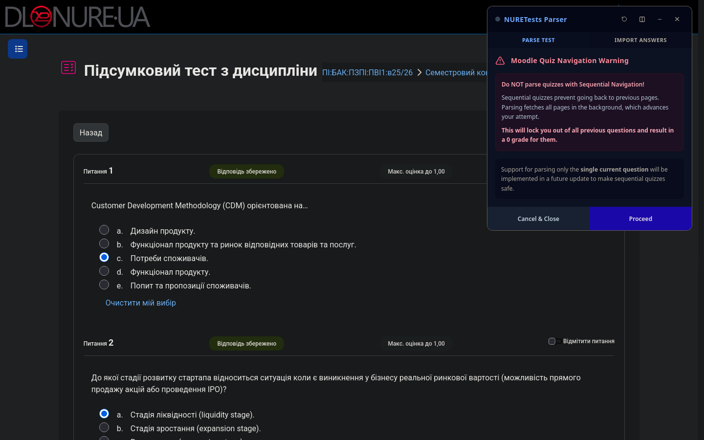
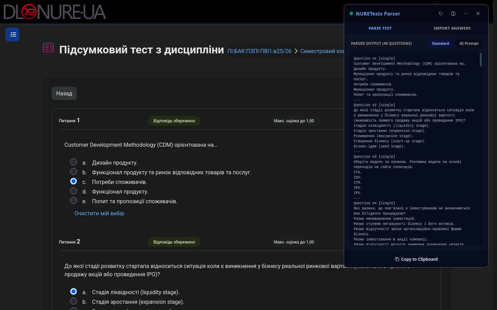
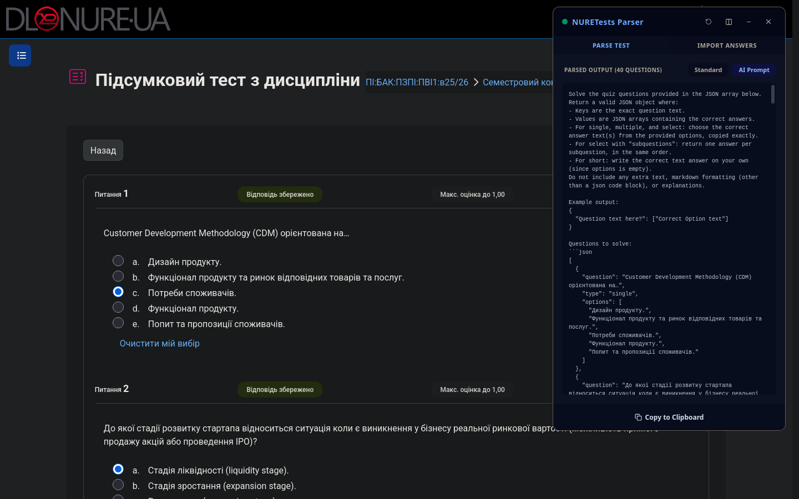
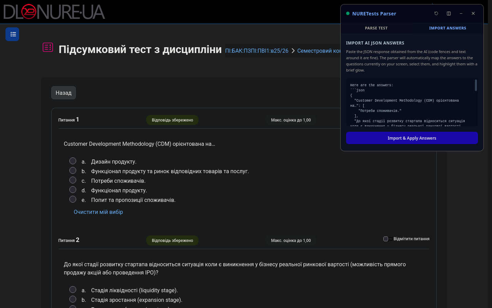
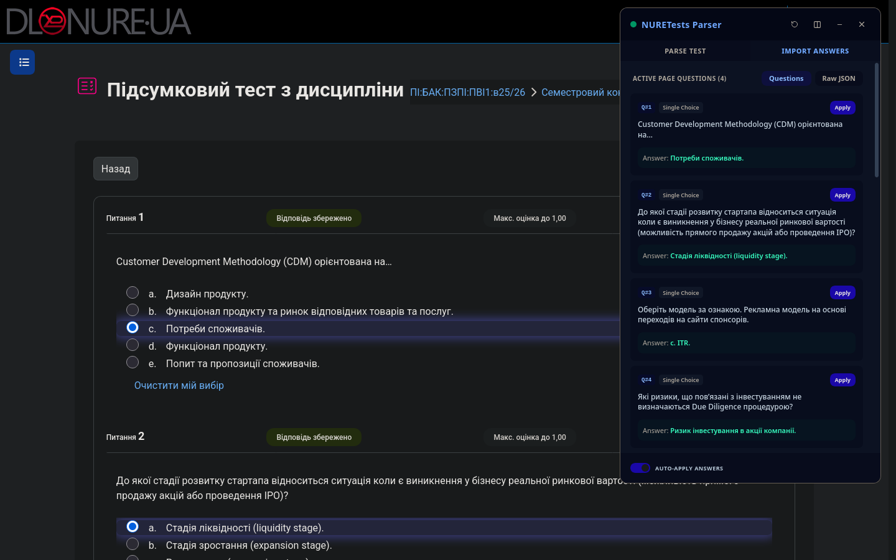
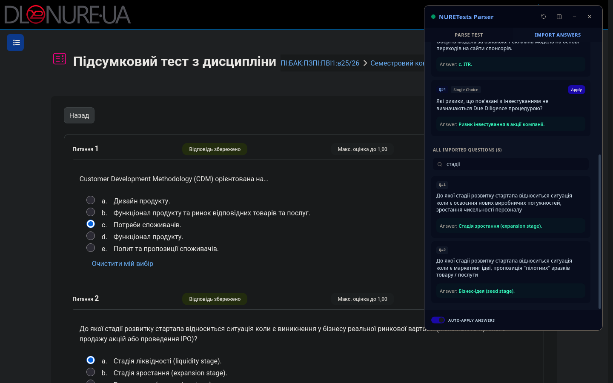
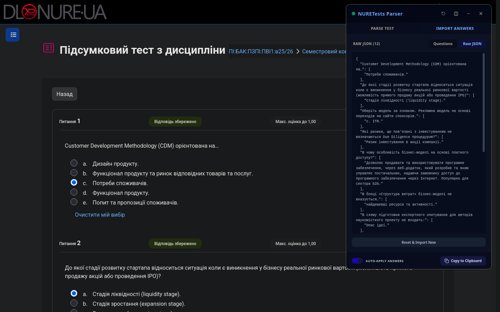
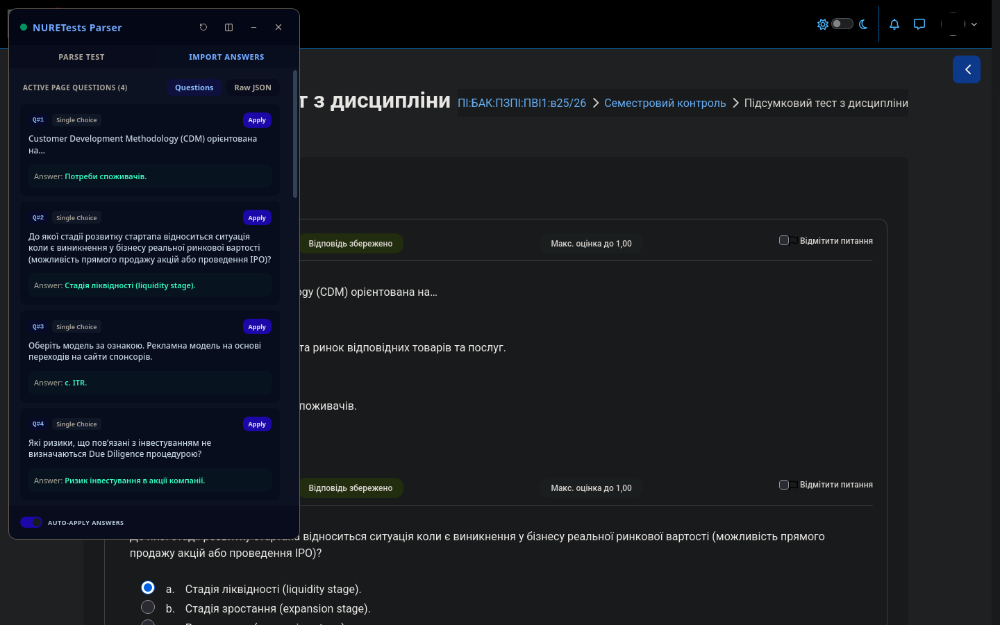

# NURETests Parser Extension

> [!NOTE]
> The original small bookmarklet script for parsing quizzes was written by [@SALOway](https://github.com/SALOway).

Browser extension for Moodle quizzes on [dl.nure.ua](https://dl.nure.ua). It scrapes the questions, builds a prompt you can paste into an LLM, takes the JSON answers back and ticks them on the page for you.

## What it does

- **Parse** – walks through every page of the attempt in the background and collects the questions. Pages that fail to load (or an expired Moodle session) are reported, with a retry button
- **Prompt** – output is either plain text or a ready-made LLM prompt, copied to clipboard in one click
- **Import** – paste what the LLM gave back. A bare JSON object, a ` ```json ` block or a reply with text around it all work
- **Auto-apply** – matches imported answers to the questions on the current page and selects them. Works with single choice, multiple choice, dropdowns (including matching and gap select questions) and short text answers. Matching tolerates the small rewrites LLMs make: different quotes or apostrophes, a missing `?`, a copied `a.` option letter. Applied fields glow for a moment so you can see what changed. On page load it only fills questions you haven't answered yourself
- **Overview** – the answers for the questions on the current page, plus a searchable list of every imported answer and the raw JSON
- **Overlay** – panel docks to the left or right edge, or collapses out of the way
- **Persistence** – active tab, panel side, parsed questions, imported answers and the auto-apply toggle survive a page reload, separately for each quiz attempt

## Screenshots

|                                                            |                                                               |
| ---------------------------------------------------------- | ------------------------------------------------------------- |
|  |     |
| Warning before parsing                                     | Parsed questions                                              |
|            |       |
| Ready-made LLM prompt                                      | Pasting the LLM reply                                         |
|         |  |
| Answers applied on the page                                | Searching all imported answers                                |
|               |              |
| Raw JSON                                                   | Panel docked to the left                                      |

## Answers format

The generated prompt asks for a JSON object where keys are the exact question text and values are arrays of correct answers:

```json
{
  "What is 2 + 2?": ["4"],
  "Pick the prime numbers": ["2", "3", "5"]
}
```

Questions with several dropdowns (matching, gap select) take one answer per dropdown, in order. Keys are question text rather than IDs, so an answers file also works for other attempts of the same quiz, where questions come in a different order.

Cloze (embedded answers) and essay questions with a rich text editor are not filled in automatically.

## Sequential quizzes

If a quiz uses sequential navigation, Moodle won't let you go back. Scraping fetches the following pages, which moves the attempt forward and leaves earlier questions unanswered. The extension warns you before scraping, but read the warning.

A single question mode that only parses the current page is planned.

## Running locally

Needs [Node.js](https://nodejs.org/) and [pnpm](https://pnpm.io/).

```bash
pnpm install
```

```bash
pnpm dev
```

`pnpm dev` rebuilds the popup and content script into `dist/` on every change, and starts a helper server on `http://localhost:3010`.

The helper server:

- saves HTML snapshots of quizzes you parse on dl.nure.ua into `.pages/default/` (gitignored), named by attempt ID. Firefox may ask whether dl.nure.ua can "access other apps and services on this device". Allow it, or nothing gets saved
- serves saved attempts back as mock quiz pages, listed on `http://localhost:3010`. Moodle's own JS is stripped, so the server adds what the mock pages need: Next/Previous and question navigation, and working drawers
- loads the extension straight into a mock page with the "With extension preloaded" link (`&ext=1`). It uses the current `dist/` build and a small `chrome.*` stand-in, so it works in any browser without installing the extension
- caches Moodle's theme CSS, fonts and images in `.pages/.cache/`. dl.nure.ua starts answering with a CAPTCHA page after many requests, and the cache keeps mock pages styled after the first load

Or all at once:

```bash
git clone https://github.com/AyloRyd/nure-tests.git && cd nure-tests && pnpm install && pnpm build && pnpm dev
```

### Loading the extension

Chrome / Chromium:

1. Open `chrome://extensions/`
2. Turn on developer mode
3. Click "Load unpacked" and pick `dist/`

Firefox:

1. Open `about:debugging`
2. Go to "This Firefox"
3. Click "Load Temporary Add-on" and pick `dist/manifest.json`

## Scripts

| Command       | What it does                    |
| ------------- | ------------------------------- |
| `pnpm dev`    | Watch build + helper server     |
| `pnpm build`  | Type-check and production build |
| `pnpm test`   | Run the unit tests              |
| `pnpm check`  | Lint + type-check + tests       |
| `pnpm format` | Run prettier over the repo      |
